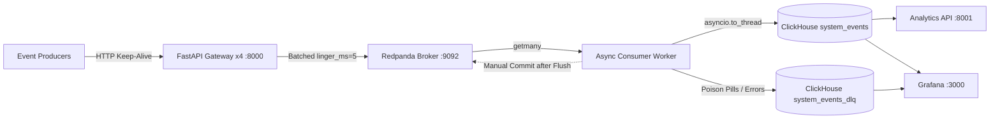

# StreamPulse

Distributed real-time log and event analytics engine built with **Redpanda (Kafka)**, **ClickHouse OLAP**, **FastAPI**, and **Grafana**, featuring producer/consumer micro-batching, strict **At-Least-Once** offset commits, and automated **Dead-Letter Queue (DLQ)** isolation.


## Architecture



### Core Engineering Design

1. **Multi-Worker ASGI Ingestion Gateway (`services/gateway`):**
   - Runs 4 Uvicorn ASGI workers (`uvloop` + `httptools`) with strict **Pydantic v2** schema validation at the HTTP boundary (rejecting malformed payloads with `HTTP 422` before they touch the broker).
   - Uses `AIOKafkaProducer` configured with **producer-side micro-batching** (`linger_ms=5`, `max_batch_size=65536`, `acks=1`) to batch high-velocity events into 64 KB TCP frames rather than blocking on per-message network round-trips.
2. **Thread-Offloaded ClickHouse Micro-Batching (`services/consumer`):**
   - Buffers incoming stream records up to `1,000` events or `1.0` second (`BATCH_TIMEOUT_SECONDS`) before writing compressed columnar parts into ClickHouse `MergeTree` tables, preventing ClickHouse part-explosion (`Error 252: Too many parts`).
   - Offloads synchronous `clickhouse-connect` socket writes to a worker thread pool via `asyncio.to_thread()` so the `asyncio` event loop and Kafka heartbeats are never blocked.
3. **Strict At-Least-Once Delivery & Dead-Letter Queue (DLQ):**
   - Configured with `enable_auto_commit=False`. The consumer commits Kafka offsets (`await consumer.commit()`) **only after** both primary and DLQ micro-batches are confirmed written to ClickHouse.
   - Records injected directly into Redpanda with invalid JSON or schema violations are isolated into `default.system_events_dlq` without halting the consumer loop.

---

## Start The Stack

Prerequisites: Docker Desktop with Compose and Python 3.11+ for local load tests.

```powershell
docker compose up -d --build
docker compose ps
```

Services:

- **Ingestion Gateway:** `http://localhost:8000/docs`
- **Analytics API:** `http://localhost:8001/docs`
- **Grafana:** `http://localhost:3000` (`admin` / `admin` for local development)
- **ClickHouse HTTP:** `http://localhost:8123`

The local example ClickHouse credentials are `default` / `admin`. Change the password in `docker-compose.yml` and `services/grafana/provisioning/datasources/clickhouse.yml` before using this outside a local environment.

---

## Send An Event

The gateway route is `POST /api/v1/events`.

```powershell
$body = '{"service_name":"checkout-service","event_type":"payment_processed","environment":["production"],"payload":"{\"order_id\":99482}","latency_ms":24}'
Invoke-RestMethod -Uri "http://localhost:8000/api/v1/events" -Method Post -ContentType "application/json" -Body $body
```

The response returns `HTTP 202 Accepted` with `{"status": "queued", "topic": "system-events"}`. HTTP schema failures return `422` and do not enter Redpanda.

---

## High-Throughput Load Testing (`10,000+` to `13,000+` req/sec)

`load_tests/load_generator.py` uses Python `multiprocessing` across OS cores combined with pre-serialized raw `HTTP/1.1 Keep-Alive` socket frames (`asyncio.open_connection`) to eliminate client-side GIL and HTTP library bottlenecks.

```powershell
# 50,000-event run
$env:TOTAL_REQUESTS = '50000'
& ".\.venv\Scripts\python.exe" ".\load_tests\load_generator.py"

# 100,000-event sustained run
$env:TOTAL_REQUESTS = '100000'
& ".\.venv\Scripts\python.exe" ".\load_tests\load_generator.py"
```

### Verified Benchmark Results

| Run Size | Workers / Sockets | Elapsed Time | Sustained Throughput | Network Errors |
| :--- | :--- | :--- | :--- | :--- |
| **50,000 events** | 4 OS Processes / 100 Sockets | **4.67 seconds** | **10,201.77 req/sec** | `0` |
| **100,000 events** | 4 OS Processes / 100 Sockets | **7.33 seconds** | **13,075.79 req/sec** | `0` |

### How We Scaled from `111.96 req/sec` to `13,075.79 req/sec` (116x Speedup)

| Stage | Bottleneck Identified | Engineering Optimization | Throughput Achieved |
| :--- | :--- | :--- | :--- |
| **1. Baseline** | Synchronous per-request broker ACK (`producer.send_and_wait`) | Every HTTP request waited on an individual network RTT to Redpanda (`446.58s` for 50k). | **111.96 req/sec** |
| **2. Producer Batching** | Per-message TCP packets between Gateway & Redpanda | Switched to `producer.send()` with `linger_ms=5`, `max_batch_size=64KB`, and `acks=1`. | **~978.51 req/sec** *(8.7x)* |
| **3. Multi-Worker ASGI** | Single Uvicorn process (1 CPU core GIL) + stdout logging I/O | Configured `--workers 4 --no-access-log` in Gateway Dockerfile + manual consumer offset commits. | **10,201.77 req/sec** *(50k in 4.67s)* |
| **4. Zero-Copy Load Gen** | Single-process `httpx` object creation & JSON serialization in hot loop | Multi-process `Pool(4)` + pre-built `HTTP/1.1 Keep-Alive` byte frames over `asyncio` sockets. | **13,075.79 req/sec** *(100k in 7.33s)* |

---

## Dead-Letter Queue (DLQ) Isolation Test

Gateway schema violations are rejected at the HTTP boundary (`422`). To test the consumer's internal DLQ path, inject malformed records directly into Redpanda:

```powershell
@('{bad-json'; '{"service_name":"dlq-test","event_type":"invalid_environment","environment":"production","payload":"bad schema","latency_ms":1}') | docker exec -i stream-pulse-redpanda rpk topic produce system-events --format '%v\n'
```

The consumer logs `Routed 2 invalid records to DLQ.`, writes the raw payloads and error reasons to `default.system_events_dlq`, and commits the offset without interrupting the stream.

---

## Grafana Dashboard

The provisioned `StreamPulse Real-Time Analytics Engine` dashboard (`http://localhost:3000`) includes:

- **Total Events Ingested**
- **Average Latency & P99 Tail Latency**
- **Events Processed Over Time**
- **Dead-Letter Event Count & DLQ Rate (%)**
- **Average Latency Over Time**

---

## Useful Checks & Test Suite

```powershell
# Check ClickHouse row counts
docker exec stream-pulse-clickhouse clickhouse-client --password admin -q "SELECT count() FROM default.system_events"
docker exec stream-pulse-clickhouse clickhouse-client --password admin -q "SELECT count() FROM default.system_events_dlq"

# Inspect consumer micro-batch & manual commit logs
docker compose logs --tail 100 consumer

# Run unit tests (verifying parser, DLQ fallback, and enable_auto_commit=False guarantees)
& ".\.venv\Scripts\python.exe" -m pytest tests/test_consumer_worker.py -v
```
