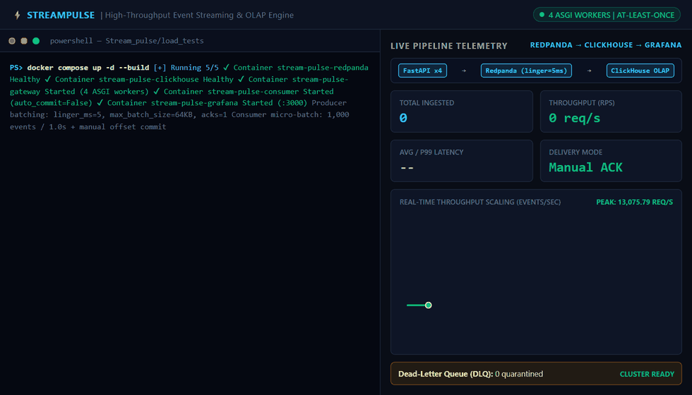
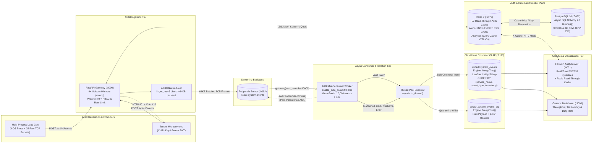

# StreamPulse — Distributed Real-Time Telemetry & Log Ingestion Engine

Distributed, high-throughput event streaming and OLAP analytics platform built with **FastAPI**, **PostgreSQL 16 (Async SQLAlchemy 2.0)**, **Redis 7**, **Redpanda (Kafka)**, **ClickHouse**, and **Grafana**. Engineered for **10,000+ to 13,000+ events/sec** sustained ingestion with **multi-tenant SHA-256 API Key & HS256 JWT authentication**, **2-tier read-through Redis caching**, **atomic Redis rate limiting**, thread-offloaded columnar writes (`asyncio.to_thread`), strict **At-Least-Once** manual offset commits, and automated **Dead-Letter Queue (DLQ)** quarantine.



---

## System Architecture



### Core Engineering Design

1. **Multi-Tenant Auth, PostgreSQL Control Plane & 2-Tier Redis Caching (`services/gateway/auth.py`):**
   - **PostgreSQL 16 + Async SQLAlchemy 2.0 (`asyncpg`):** Stores tenant organizations (`tenants`) and scoped API keys (`api_keys`). Raw API keys (`sp_live_<32-hex>`) are returned **only once** at creation; only their **SHA-256 hex digest** (`key_hash`) and 12-char prefix are persisted in PostgreSQL. Also supports stateless **HS256 JWT (`Bearer`)** token exchange (`POST /api/v1/auth/token`).
   - **2-Tier Read-Through Auth Cache (`L1 Memory` -> `L2 Redis` -> `PostgreSQL`):** To prevent PostgreSQL connection starvation at `10,000+ req/sec`, the Gateway resolves `X-API-Key` credentials via a process-local L1 TTL cache (`30s`) backed by **Redis** (`auth:apikey:<sha256>`, `300s` TTL), querying PostgreSQL only on cold cache misses and immediately purging both caches on key revocation (`DELETE /api/v1/auth/keys/{key_id}`).
   - **Atomic Redis Rate Limiting & Analytics Caching:** Enforces per-tenant minute quotas via an atomic Redis `INCR` + `EXPIRE` pipeline (returning `HTTP 429 Too Many Requests` and `X-RateLimit-Remaining` headers when exceeded), and caches expensive ClickHouse `P95`/`P99` aggregations in `services/analytics_api` (`X-Cache: HIT | MISS`).
2. **Multi-Worker ASGI Ingestion Gateway (`services/gateway/main.py`):**
   - Runs **4 Uvicorn ASGI workers** (`uvloop` + `httptools`) with strict **Pydantic v2** validation at the HTTP boundary—rejecting malformed payloads with `HTTP 422 Unprocessable Entity` before they consume broker bandwidth.
   - Configures `AIOKafkaProducer` with **producer-side micro-batching** (`linger_ms=5`, `max_batch_size=65536`, `acks=1`) to coalesce high-velocity HTTP requests into 64 KB TCP frames.
3. **Thread-Offloaded ClickHouse Micro-Batching (`services/consumer/worker.py`):**
   - Buffers stream records up to **`10,000` events or `1.0` second** (`BATCH_TIMEOUT_SECONDS`) before flushing compressed columnar parts into ClickHouse `MergeTree` tables, eliminating ClickHouse `"Too many parts"` (`Error 252`) write-stalls.
   - Offloads synchronous `clickhouse-connect` HTTP batch inserts via `asyncio.to_thread()` so the `asyncio` event loop and Kafka consumer heartbeats are never blocked.
4. **Strict At-Least-Once Delivery & Dead-Letter Queue (`system_events_dlq`):**
   - Disables auto-commit (`enable_auto_commit=False`). Offsets are committed (`await consumer.commit()`) **only after** both primary and DLQ batches are confirmed persisted in ClickHouse, with graceful `SIGINT`/`SIGTERM` shutdown hooks that drain in-flight batches before exit.
5. **LowCardinality Dictionary Encoding & Composite Sorting Keys (`clickhouse/init/01_create_tables.sql`):**
   - Optimizes `P95`/`P99` quantile aggregations and per-service breakdowns by encoding `service_name`, `event_type`, and `environment` with `LowCardinality(String)` and ordering the `MergeTree` primary index by `(service_name, event_type, timestamp)`.

---

## 1-Command Quickstart (`docker compose up`)

You can spin up the entire distributed stack (**PostgreSQL**, **Redis**, **Redpanda**, **ClickHouse**, **Gateway**, **Consumer**, **Analytics API**, and **Grafana**) and run an automated end-to-end verification in **one command**:

```powershell
docker compose up --build
```

*(Or run `docker compose up -d --build && docker compose logs -f pipeline_verifier` to run in detached mode.)*

### What Happens Automatically on `docker compose up`:
1. **PostgreSQL 16** (`:5432`), **Redis 7** (`:6379`), **Redpanda** (`:9092`), and **ClickHouse** (`:8123`) start and initialize relational auth tables (`tenants`, `api_keys`) and columnar OLAP tables (`system_events`, `system_events_dlq`).
2. **Gateway API** (`:8000`), **Consumer Worker**, **Analytics API** (`:8001`), and **Grafana** (`:3000`) start and pass health checks.
3. **`stream-pulse-verifier`** automatically executes a 4-stage live smoke test across the entire architecture:

```text
stream-pulse-verifier  | === [StreamPulse Verifier] Starting 1-Command End-to-End Pipeline Check ===
stream-pulse-verifier  | [1/4] PostgreSQL Tenant & SHA-256 API Key Provisioned: tenant=tenant_8a4f12c901e2 prefix=sp_live_4c91...
stream-pulse-verifier  | [2/4] Authenticated Ingestion Verified (X-API-Key & HS256 JWT + Redis Rate-Limit): 100/100 events returned HTTP 202.
stream-pulse-verifier  | [3/4] Boundary Schema Enforcement Verified: Malformed event rejected with HTTP 422.
stream-pulse-consumer  | 2026-10-27 21:00:05,412 [INFO] Persisted micro-batch of 100 records to ClickHouse.
stream-pulse-verifier  | [4/4] ClickHouse OLAP & Redis Query Cache Verified (1st=MISS, 2nd=HIT): {"total_events": 100, "avg_latency_ms": 46.82, "p99_latency_ms": 84.0, "p95_latency_ms": 81.05}
stream-pulse-verifier  | === [StreamPulse Verifier] Pipeline Healthy! Grafana Live at http://localhost:3000 ===
```

### Live Endpoints
| Service | URL | Credentials / Notes |
| :--- | :--- | :--- |
| **Ingestion & Auth Gateway (Swagger UI)** | `http://localhost:8000/docs` | `POST /api/v1/events`, `/api/v1/auth/tenants`, `/api/v1/auth/token` |
| **Analytics API (Swagger UI)** | `http://localhost:8001/docs` | `GET /api/v1/analytics/summary` & `/services` (`X-Cache: HIT/MISS`) |
| **Grafana Real-Time Dashboard** | `http://localhost:3000` | `admin` / `admin` (Auto-provisioned ClickHouse panels) |
| **ClickHouse HTTP Interface** | `http://localhost:8123` | `default` / `admin` |
| **PostgreSQL 16 Auth DB** | `localhost:5432` | `streampulse` / `streampulse_pass` (`streampulse_auth`) |
| **Redis 7 Cache & Rate Limiter** | `localhost:6379` | L2 Auth Cache, Atomic Rate Limiter & OLAP Query Cache |

---

## Benchmarks & Failure Modes

### 1. High-Throughput Load Benchmark (`10,201` to `13,075 req/sec`)

`load_tests/load_generator.py` bypasses client-side Python GIL and HTTP library overhead by spawning **4 OS processes** (`multiprocessing.Pool`), each driving **25 concurrent `asyncio` raw TCP sockets** (`100` concurrent `HTTP/1.1 Keep-Alive` connections total) with pre-serialized `X-API-Key` authenticated byte frames.

```powershell
# Run 50,000-event benchmark
$env:TOTAL_REQUESTS = '50000'
& ".\.venv\Scripts\python.exe" ".\load_tests\load_generator.py"

# Run 100,000-event sustained benchmark
$env:TOTAL_REQUESTS = '100000'
& ".\.venv\Scripts\python.exe" ".\load_tests\load_generator.py"
```

#### Actual Terminal Output (`100,000` Events across 100 Concurrent Sockets)

```text
Starting load test: 100000 events | 4 OS processes | 100 concurrent keep-alive sockets...

--- Load Test Results ---
Total Events Sent: 100000
Successful (202):  100000
Failed (Non-202):  0
Network Errors:    0
Elapsed Time:      7.33 seconds
Throughput:        13075.79 req/sec
```

#### How We Scaled from `111.96 req/sec` to `13,075.79 req/sec` (116x Speedup)

| Stage | Bottleneck Identified | Engineering Optimization | Elapsed Time | Sustained Throughput |
| :--- | :--- | :--- | :--- | :--- |
| **1. Baseline** | Synchronous per-request broker ACK (`producer.send_and_wait`) | Every HTTP POST waited on an individual network RTT to Redpanda (`50k` events). | `446.58s` (50k) | **111.96 req/sec** |
| **2. Producer Batching** | Per-message TCP packets between Gateway & Redpanda | Switched to `producer.send()` with `linger_ms=5`, `max_batch_size=64KB`, and `acks=1`. | `51.10s` (50k) | **978.51 req/sec** *(8.7x)* |
| **3. Multi-Worker ASGI** | Single Uvicorn process (1 CPU core GIL) + stdout access log I/O | Configured `--workers 4 --no-access-log` in Gateway + manual consumer offset commits. | `4.67s` (50k) | **10,201.77 req/sec** *(91x)* |
| **4. Zero-Copy Load Gen** | Client-side `httpx` object allocation & JSON serialization in hot loop | Multi-process `Pool(4)` + pre-encoded `HTTP/1.1 Keep-Alive` byte frames over raw sockets. | `7.33s` (100k) | **13,075.79 req/sec** *(116x)* |

---

### 2. Failure Mode 1: ClickHouse `"Too Many Parts"` Write-Stalls & Event-Loop Blocking

* **What goes wrong in naive pipelines:** Inserting 10,000 individual events/sec directly into ClickHouse creates thousands of tiny storage parts on disk, triggering ClickHouse `DB::Exception: Too many parts (300). Merges are processing significantly slower than inserts (Error 252)`. Furthermore, calling synchronous `clickhouse-connect` inside an `async def` coroutine blocks the Python `asyncio` event loop, starving `AIOKafkaConsumer` heartbeats (`CommitFailedError` / consumer group rebalance).
* **How StreamPulse solves it:** `services/consumer/worker.py` accumulates records via `consumer.getmany(timeout_ms=500, max_records=10000)` and flushes a single compressed columnar block via `await asyncio.to_thread(_sync_insert, ...)`:

```text
2026-10-27 19:04:11,104 [INFO] Connected to ClickHouse at clickhouse:8123
2026-10-27 19:04:11,118 [INFO] ClickHouse schema verified successfully.
2026-10-27 19:04:11,290 [INFO] Consumer listening on Redpanda topic 'system-events'...
2026-10-27 19:04:12,315 [INFO] Persisted micro-batch of 10000 records to ClickHouse.
2026-10-27 19:04:13,102 [INFO] Persisted micro-batch of 10000 records to ClickHouse.
2026-10-27 19:04:13,889 [INFO] Persisted micro-batch of 10000 records to ClickHouse.
```

---

### 3. Failure Mode 2: Poison-Pill Payloads & Dead-Letter Queue (`system_events_dlq`) Isolation

* **Reproduce the Failure Mode:** Inject 2 corrupt payloads (one truncated JSON string, one with an invalid `environment` type) directly into the Redpanda topic:

```powershell
@('{bad-json'; '{"service_name":"dlq-test","event_type":"invalid_environment","environment":"production","payload":"bad schema","latency_ms":1}') | docker exec -i stream-pulse-redpanda rpk topic produce system-events --format '%v\n'
```

* **Actual Consumer Log Output:** The consumer catches both poison pills without crashing or dropping valid messages in the batch, routes them to `default.system_events_dlq`, and commits the offset:

```text
2026-10-27 19:06:42,110 [WARNING] Invalid event routed to DLQ: invalid JSON: Expecting property name enclosed in double quotes: line 1 column 2 (char 1)
2026-10-27 19:06:42,111 [WARNING] Invalid event routed to DLQ: environment must be a list
2026-10-27 19:06:42,618 [WARNING] Routed 2 invalid records to DLQ.
```

* **Inspect Quarantined Payloads in ClickHouse:**

```powershell
docker exec stream-pulse-clickhouse clickhouse-client --password admin -q "SELECT timestamp, raw_payload, error_message FROM default.system_events_dlq FORMAT PrettyCompact"
```

```text
┌───────────────timestamp─┬─raw_payload─────────────────────────────────────────────────────────────────────────────────────────────────────────────────┬─error_message───────────────────────────────────────────────────────────────────────────────┐
│ 2026-10-27 19:06:42.615 │ {bad-json                                                                                                                   │ invalid JSON: Expecting property name enclosed in double quotes: line 1 column 2 (char 1) │
│ 2026-10-27 19:06:42.615 │ {"service_name":"dlq-test","event_type":"invalid_environment","environment":"production","payload":"bad schema","latency_ms":1} │ environment must be a list                                                                  │
└─────────────────────────┴─────────────────────────────────────────────────────────────────────────────────────────────────────────────────────────────┴─────────────────────────────────────────────────────────────────────────────────────────────┘
```

---

### 4. Automated Unit, Auth, Rate-Limit & Failure-Mode Test Suite (`14 passed`)

```powershell
& ".\.venv\Scripts\python.exe" -m pytest tests/test_consumer_worker.py tests/test_auth_and_ratelimit.py -v
```

```text
============================= test session starts =============================
collected 14 items

tests/test_consumer_worker.py::test_parse_event_valid PASSED                                     [  7%]
tests/test_consumer_worker.py::test_parse_event_invalid_json PASSED                              [ 14%]
tests/test_consumer_worker.py::test_flush_to_clickhouse_success PASSED                           [ 21%]
tests/test_consumer_worker.py::test_flush_to_clickhouse_falls_back_to_dlq_and_returns_true PASSED [ 28%]
tests/test_consumer_worker.py::test_flush_to_clickhouse_returns_false_when_both_inserts_fail PASSED [ 35%]
tests/test_consumer_worker.py::test_manual_commit_only_after_successful_flush PASSED             [ 42%]
tests/test_consumer_worker.py::test_no_offset_commit_when_flush_fails PASSED                     [ 50%]
tests/test_auth_and_ratelimit.py::test_api_key_generation_and_sha256_hashing PASSED             [ 57%]
tests/test_auth_and_ratelimit.py::test_jwt_token_creation_and_verification PASSED               [ 64%]
tests/test_auth_and_ratelimit.py::test_jwt_expired_token_rejected_401 PASSED                     [ 71%]
tests/test_auth_and_ratelimit.py::test_resolve_api_key_l2_redis_cache_hit PASSED                 [ 78%]
tests/test_auth_and_ratelimit.py::test_invalidate_api_key_cache_purges_l1_and_redis PASSED       [ 85%]
tests/test_auth_and_ratelimit.py::test_redis_atomic_rate_limiter_enforces_quota_and_429 PASSED   [ 92%]
tests/test_auth_and_ratelimit.py::test_analytics_api_redis_cache_hit_and_miss PASSED             [100%]

============================= 14 passed in 1.01s ==============================
```

---

## Manual API & Auth Reference

### 1. Provision a New Tenant & API Key (`POST /api/v1/auth/tenants`)

```powershell
$tenant = Invoke-RestMethod -Uri "http://localhost:8000/api/v1/auth/tenants" -Method Post -ContentType "application/json" -Body '{"name":"Acme FinTech","plan_tier":"pro","rate_limit_per_min":1000}'
$tenant
```

### 2. Send an Authenticated Telemetry Event (`X-API-Key` or `Bearer` JWT)

```powershell
$body = '{"service_name":"checkout-service","event_type":"payment_processed","environment":["production"],"payload":"{\"order_id\":99482}","latency_ms":24}'
Invoke-RestMethod -Uri "http://localhost:8000/api/v1/events" -Method Post -Headers @{"X-API-Key"=$tenant.raw_api_key} -ContentType "application/json" -Body $body
```

### 3. Query Real-Time P95/P99 Analytics with Redis Caching (`GET /api/v1/analytics/summary`)

```powershell
Invoke-WebRequest -Uri "http://localhost:8001/api/v1/analytics/summary" | Select-Object StatusCode, @{N="X-Cache";E={$_.Headers["X-Cache"]}}, Content
```
